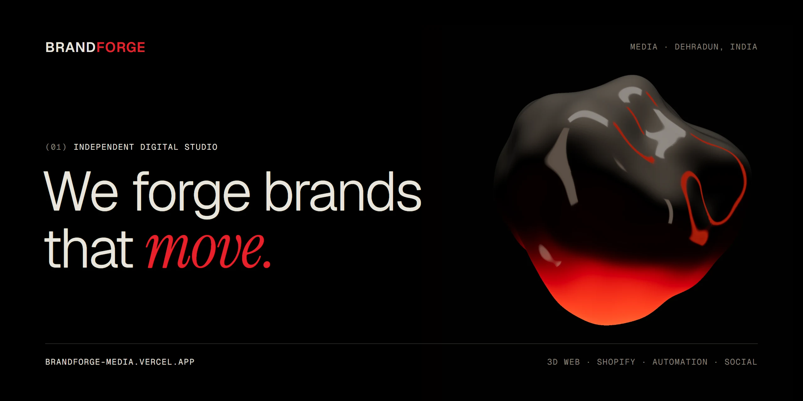
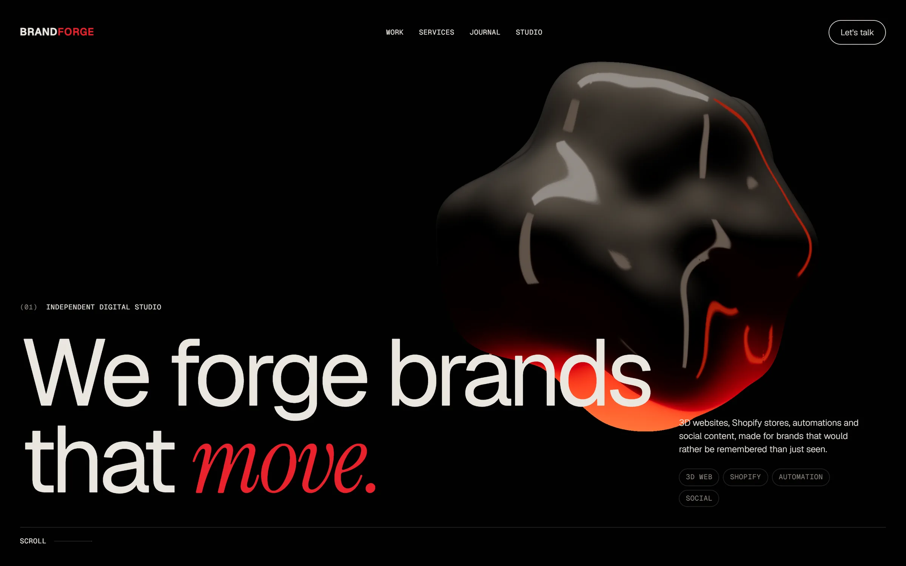
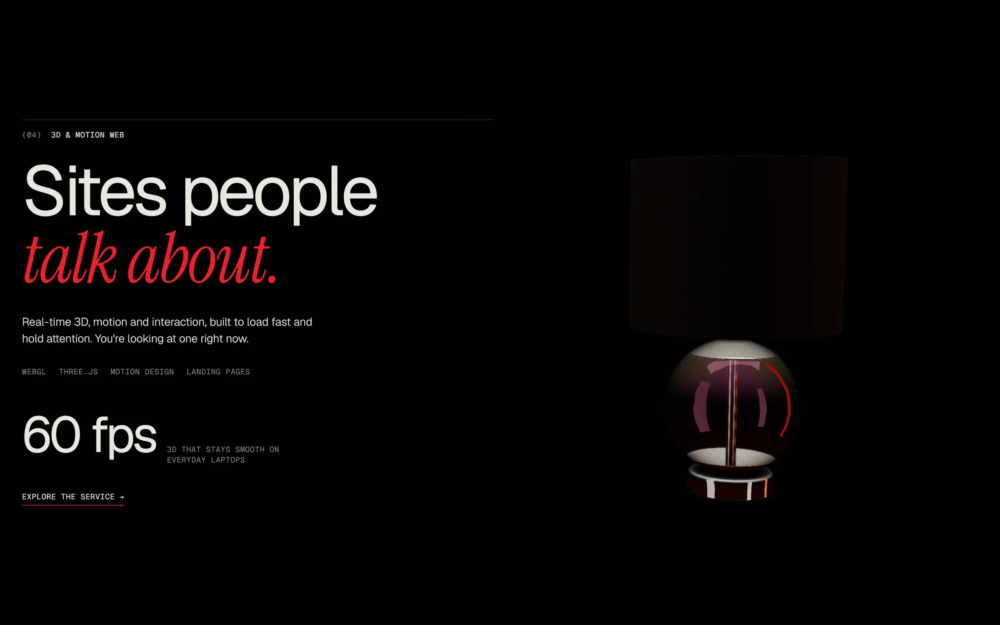
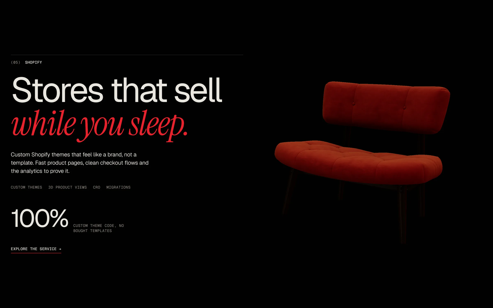
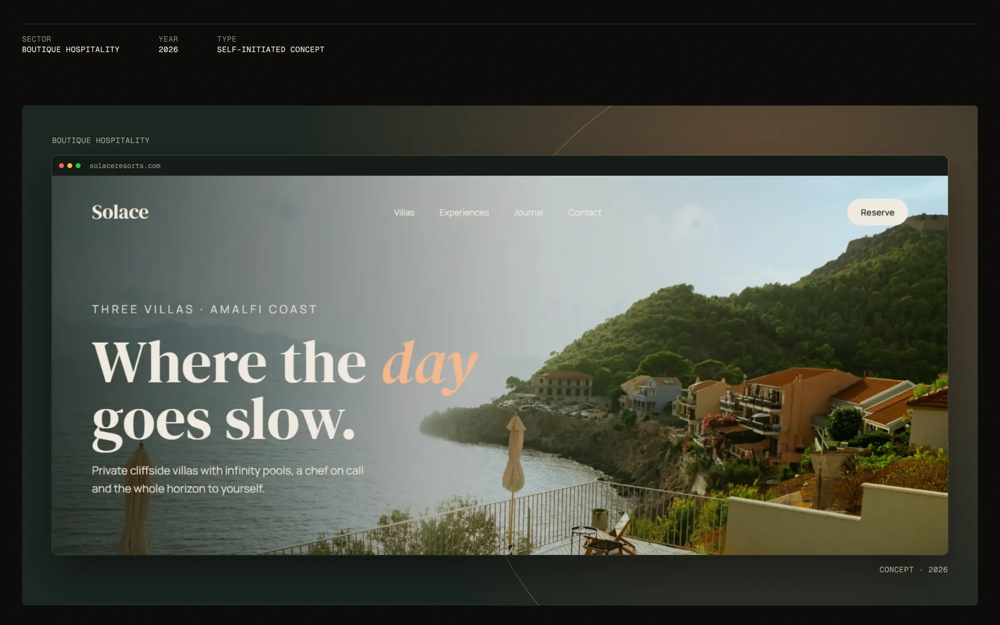
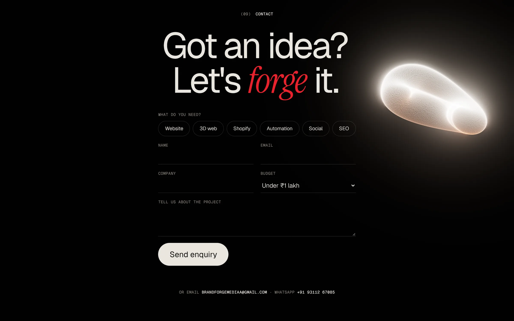
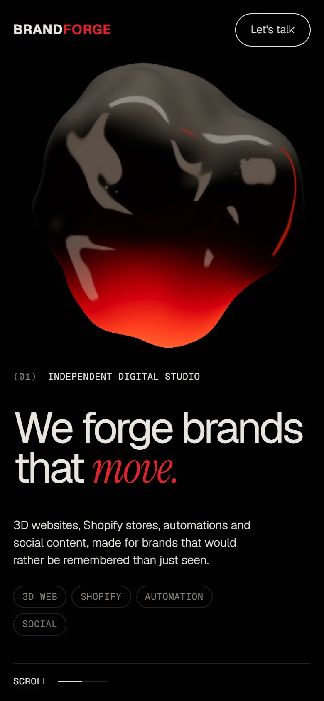

<a href="https://brandforge-media.vercel.app">
  
</a>

<p align="center">
  <b>The studio website of BrandForge Media</b>, an independent digital studio in Dehradun, India.<br />
  Real-time 3D, scroll-driven motion and 33 static, search-ready pages.
</p>

<p align="center">
  <a href="https://brandforge-media.vercel.app"><b>Live site</b></a> ·
  <a href="https://brandforge-media.vercel.app/work.html">Work</a> ·
  <a href="https://brandforge-media.vercel.app/services/website-design.html">Services</a> ·
  <a href="https://brandforge-media.vercel.app/journal/">Journal</a> ·
  <a href="https://brandforge-media.vercel.app/#contact">Start a project</a>
</p>

<p align="center">
  <a href="https://brandforge-media.vercel.app"></a>
  
  
  
  
</p>

<br />



<table>
  <tr>
    <td width="50%"></td>
    <td width="50%"></td>
  </tr>
  <tr>
    <td width="50%"></td>
    <td width="50%"></td>
  </tr>
</table>

<table>
  <tr>
    <td width="30%"></td>
    <td width="70%">

### What's inside

**A 3D scene that changes as you scroll.** One Three.js engine morphs a molten chrome form into a product for each service (a watch, a lamp, a chair, a camera) and finally into a rotating particle ring. It uses a custom dissolve shader, studio lighting and bloom.

**Motion choreography.** GSAP ScrollTrigger and Lenis smooth scrolling drive headline reveals, word-by-word paragraphs and every 3D keyframe. If a visitor's device asks for reduced motion, smooth scrolling and the 3D animation pause.

**Fast by design.** The 3D engine loads only on the home page. Four product models total about 2.3 MB after mesh and texture compression, and phones get a lighter scene that loads sooner.

**Built to be found.** 33 static HTML pages for services, cities, case studies and articles, with JSON-LD schema, breadcrumbs, a sitemap, `llms.txt` for AI search and IndexNow.

</td>
  </tr>
</table>

## Stack

| | |
|---|---|
| **Build** | [Vite](https://vite.dev) multi-page app, plain JavaScript, no framework |
| **3D** | [Three.js](https://threejs.org) with EffectComposer and UnrealBloom, glTF models compressed with meshopt and WebP |
| **Motion** | [GSAP](https://gsap.com) and ScrollTrigger, [Lenis](https://lenis.darkroom.engineering) smooth scroll |
| **Pages** | `scripts/pages.mjs` writes every service, city, case-study and journal page from data in `src/` |
| **Hosting** | [Vercel](https://vercel.com). Each push to `main` deploys to production. |

## Develop

```bash
npm install
npm run dev      # http://localhost:5173
npm run build    # production build in dist/
```

Both commands first run `scripts/pages.mjs`, which writes `/india/`, `/services/`, `/work/`, `/journal/` and `public/sitemap.xml`. Those files are git-ignored and rebuilt every time, so edit the data in `src/` instead.

<details>
<summary><b>Project structure</b></summary>
<br />

| Path | What it is |
|---|---|
| `index.html`, `work.html` | Hand-written home and work pages. The project cards between the `<!--projects-->` markers are filled at build time. |
| `src/content.js` | Services (with prices) and journal articles |
| `src/locations.js` | City pages: `/india/<slug>.html` |
| `src/local.js` | Dehradun service pages (website, SEO, digital marketing, hotels, Shopify) |
| `src/projects.js`, `src/stories.js` | Concept case studies: `/work/<slug>.html` |
| `scripts/pages.mjs` | The page generator: layout, schema, breadcrumbs, internal links, sitemap |
| `partials/` | Shared header and footer for generated pages. `index.html` and `work.html` embed copies, so keep them in sync. |
| `src/main.js` | Scroll, cursor, header and the enquiry form |
| `src/forge.js` | The Three.js scene on the home page |
| `public/` | 3D models, case-study shots, favicons, `llms.txt`, `robots.txt`, the IndexNow key |
| `mockups/` | Design sources for the case-study shots and this README's banner |
| `marketing/` | Keyword research, directory listings and Google Business Profile copy (not part of the site) |

</details>

<details>
<summary><b>Adding a page</b></summary>
<br />

- **City:** add an entry to `src/locations.js`. Keep the title to 60 characters or fewer and `metaDesc` to 155 or fewer.
- **Article:** add to `posts` in `src/content.js`.
- **Service:** add to `services` in `src/content.js`.

The sitemap, breadcrumbs, schema and internal links update on the next build. After it deploys, request indexing for the new URL in Google Search Console.

</details>

<details>
<summary><b>Repo images</b></summary>
<br />

The screenshots in `.github/media/` are real captures of the live site at 2x. The banner and `social-preview.png` are rendered from `mockups/github-banner.html`, using a frame of the live 3D scene in `mockups/photos/forge-blob.png`.

</details>

<br />

<p align="center">
  <b>BRAND<span>FORGE</span></b> · Media<br />
  <sub>Dehradun, Uttarakhand, India · <a href="https://brandforge-media.vercel.app">brandforge-media.vercel.app</a> · <a href="mailto:brandforgemediaa@gmail.com">brandforgemediaa@gmail.com</a></sub><br />
  <sub>© 2026 BrandForge Media. All rights reserved.</sub>
</p>
